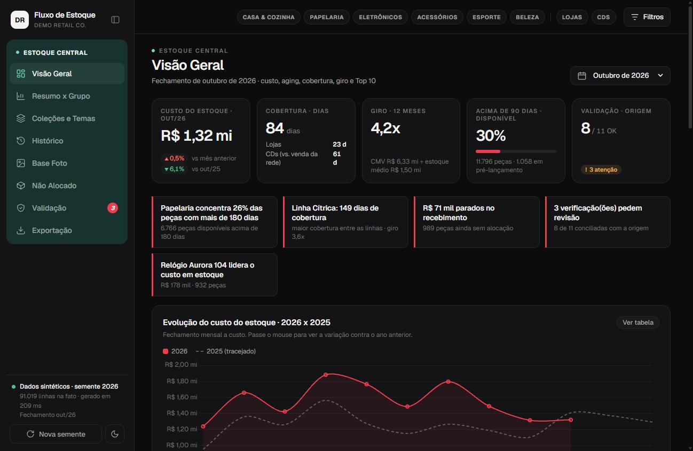
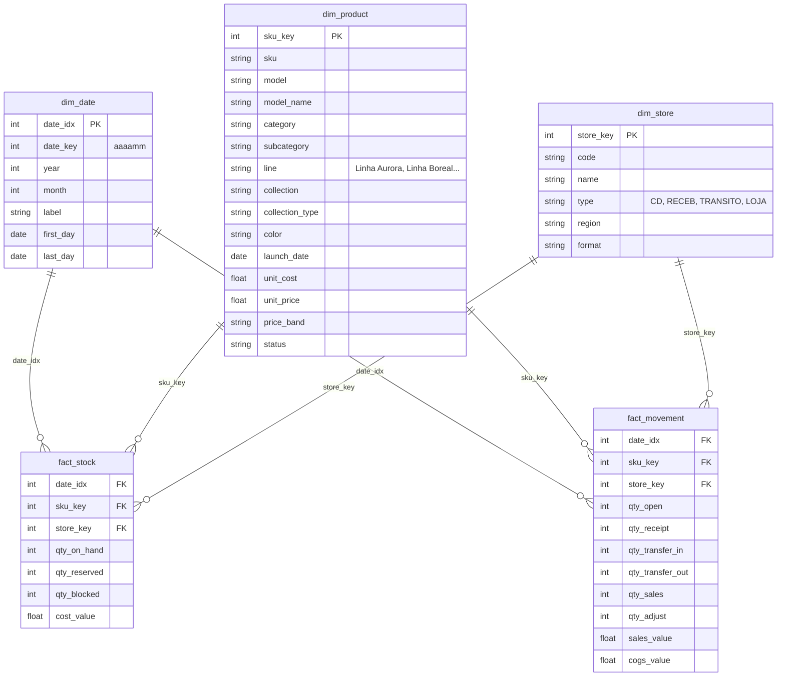

# Inventory Flow Analytics

**▶ [Demo ao vivo](https://viniboricuo.github.io/inventory-flow-analytics/)** · Star Schema (2 fatos, 3 dimensões) · aging, cobertura e giro · validação contra a origem



**Em números:** ~91 mil linhas na fato agregadas no navegador em milissegundos · ~400 SKUs, 32 lojas e 3 CDs · 24 meses de histórico · 11 conciliações com a origem, com divergências plantadas para a validação encontrar

> **Projeto de portfólio. Marca, dados e código fictícios, gerados sinteticamente; não contém código, dados, fotos ou logos de nenhuma empresa.**

## English summary

**Inventory Flow Analytics** is a static, client-side dashboard that shows how stock moves through a retail network
(distribution centers, receiving area, in-transit and stores) for a fictional brand, **Demo Retail Co.**

Everything is generated in the browser by a **seeded, deterministic** synthetic data generator (`js/data.js`) that builds an
inventory **star schema** in memory. The app then computes the analytics on the fly:

- **Stock aging**: available pieces bucketed by days since the SKU's last purchase receipt (0–30, 31–60, 61–90, 91–180, 181–365, 365+, pre-launch).
- **Coverage (days of cover)**: stock on hand ÷ average daily sales over the last 3 months.
- **Turnover**: annualized cost of goods sold (12 months) ÷ average stock at cost.
- **Top 10**: models ranked by stock value, 3-month sales, highest coverage or lowest turnover.
- **Validation against the source**: totals on the fact table vs. what the "source system" reports, plus data-quality rules,
  with OK / warning / fail badges. A few realistic discrepancies are planted on purpose so the checks have something to find.

Filters (category, subcategory, line, collection, price band, product status, region, location type, location, SKU text) and the
reference month change every number and are kept in the URL. Tables export to CSV in the browser.

**Run it:** download or clone the folder and double-click `index.html`. No build, no server, no backend.
It also works as-is on GitHub Pages (all paths are relative). Chart.js 4.4.1 (cdnjs) and the Geist font (Google Fonts) are
loaded from CDNs; without internet the page still works and the charts fall back to their "Ver tabela" tables.

Stack: plain HTML + CSS + JavaScript (no framework), Chart.js for charts.

---

## Resumo em português

**Inventory Flow Analytics** é um painel estático (só front-end) que mostra o fluxo de estoque de uma rede de varejo fictícia,
a **Demo Retail Co.**: centros de distribuição, área de recebimento, mercadoria em trânsito e lojas. Os produtos são de
categorias genéricas e variadas: Casa & Cozinha, Papelaria, Eletrônicos, Acessórios, Esporte e Beleza.

### Como rodar

1. Baixe ou clone esta pasta.
2. Dê dois cliques em **`index.html`**. Pronto: não há build, servidor nem banco de dados.
3. Para publicar, suba a pasta no GitHub e ative o **GitHub Pages** (os caminhos são todos relativos).

O Chart.js 4.4.1 vem do cdnjs e a fonte Geist do Google Fonts. Sem internet a página continua funcionando; os gráficos dão
lugar às tabelas ("Ver tabela").

### Páginas

| Página | O que mostra |
|---|---|
| **Visão Geral** | destaques clicáveis, evolução do custo do estoque (ano atual × anterior), estoque acima de 180 dias, custo por categoria em 12 meses, peças × custo, aging por categoria, mapa de cobertura (faixa de preço / região / tipo de coleção) e **Top 10** |
| **Resumo x Grupo** | mapa de calor *etapa do fluxo × categoria* (recebimento, CD disponível/reservado/bloqueado, trânsito, lojas) com detalhe por local, disponível por categoria e região, lojas por região (cobertura e giro) |
| **Coleções e Temas** | estoque por linha, coleções sazonais fora da janela de venda e próximos lançamentos, dispersão cobertura × giro, aging por linha, estoque em R$ por categoria e subcategoria |
| **Histórico** | série mensal de estoque, vendas, recebimentos, cobertura e giro, por linha e período, com sparklines por linha |
| **Base Foto** | galeria de modelos com estoque; as “fotos” são **ícones genéricos por categoria** (SVG), nunca fotos de produto; gaveta de detalhe por modelo |
| **Não Alocado** | peças paradas no recebimento do CD, tempo sem alocação, impacto por categoria, lista agrupada por linha com status anotável (salvo só no navegador) |
| **Validação** | conciliação da fato com a origem (totais e % de diferença com tolerância ajustável), regras de qualidade e matriz categoria × mês |
| **Exportação** | tabela dinâmica: escolha dimensões e medidas, ordene, filtre e baixe CSV |

A faixa de KPIs no topo (custo do estoque, cobertura, giro, % acima de 90 dias e validação) aparece em todas as páginas.
Os filtros e o mês de referência ficam na URL, então dá para compartilhar um link já filtrado. Há tema claro/escuro e o menu
lateral pode ser recolhido.

### Conceitos

- **Modelo estrela**: duas tabelas fato no grão *mês × SKU × local* (`fact_stock` com saldos e `fact_movement` com fluxos),
  ligadas a três dimensões (`dim_date`, `dim_product`, `dim_store`). As fatos ficam em colunas (*typed arrays*) para que os
  agregados de ~90 mil linhas rodem em milissegundos no navegador.
- **Aging**: idade do estoque disponível = dias desde o último recebimento de compra do SKU (aproximação FIFO); itens que ainda
  não foram lançados ficam como *pré-lançamento*.
- **Cobertura (dias)**: estoque ÷ (venda dos últimos 3 meses ÷ dias do período).
- **Giro**: CMV dos últimos 12 meses (anualizado) ÷ estoque médio a custo no mesmo período.
- **Validação contra a origem**: o gerador grava, em paralelo à fato, o que o “sistema de origem” informaria (granularidade
  *mês × categoria × região*). A página compara os dois e roda regras de qualidade: equação de fluxo
  (abertura + entradas − saídas ± ajustes = fechamento), continuidade entre meses, integridade referencial, unicidade do grão,
  estoque negativo e comprometido ≤ saldo. Algumas divergências são plantadas de propósito (vendas lançadas depois do corte,
  reavaliação de custo, ajuste de inventário e duas linhas com erro de carga) para que a validação tenha o que encontrar.

### Modelo de dados



Além disso, `source_ledger` guarda os totais da origem (mês × categoria × região) usados só pela página **Validação**.

Versão em texto:

```
                 dim_date (mês)
                      |
dim_product (SKU) — fact_stock / fact_movement — dim_store (CD, recebimento, trânsito, loja)
          grão: mês × SKU × local   (24 meses: nov/24 a out/26)
```

### Dados sintéticos

- Semente padrão **2026**: os mesmos números sempre. O botão **Nova semente** gera outro conjunto (a semente vai para a URL).
- ~400 SKUs (≈150 modelos × cores), 14 linhas fictícias (“Linha Aurora”, “Linha Boreal”, …), 15 coleções (permanentes,
  sazonais e cápsulas), 3 CDs, 1 área de recebimento, 1 local de trânsito e 32 lojas em 5 regiões.
- A simulação mês a mês inclui sazonalidade, ciclo de vida das coleções, compras e recompras, alocação CD → trânsito → loja,
  vendas, remarcação de fim de coleção e pequenas perdas.
- Todos os nomes (marca, linhas, coleções, lojas, produtos) são inventados.

### Estrutura

| Arquivo | Conteúdo |
|---|---|
| `index.html` | casca da página (menu lateral, barra de filtros, cabeçalho, KPIs) |
| `css/style.css` | tema claro/escuro por variáveis CSS, layout responsivo |
| `js/data.js` | gerador determinístico do modelo estrela |
| `js/core.js` | estado, filtros, motor de métricas (aging, cobertura, giro), validação, gráficos, tabelas, CSV, roteamento |
| `js/pages-analysis.js` | Visão Geral, Resumo x Grupo, Coleções e Temas, Histórico |
| `js/pages-operations.js` | Base Foto, Não Alocado, Validação, Exportação |

### Aviso

**Projeto de portfólio. Marca, dados e código fictícios, gerados sinteticamente; não contém código, dados, fotos ou logos de nenhuma empresa.**
Qualquer semelhança com marcas, lojas ou produtos reais é coincidência.

Licença: [MIT](LICENSE).
